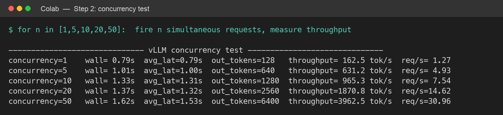
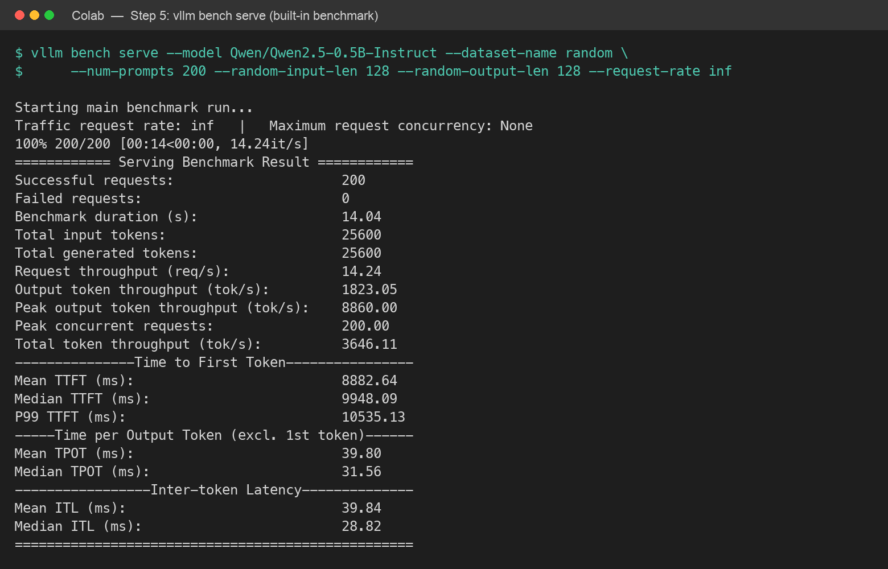

# High-Throughput LLM Serving with vLLM

Measuring **why vLLM exists** — latency, throughput, concurrency, GPU memory — by serving a real
model and load-testing it, rather than just chatting with it. Serving engine: **[vLLM](https://github.com/vllm-project/vllm) 0.30.0**.
Model: **Qwen2.5-0.5B-Instruct**. Hardware: **NVIDIA Tesla T4 (16 GB)** on Google Colab.

> vLLM requires an NVIDIA CUDA GPU, so it cannot run on Apple Silicon or natively on Windows (use WSL).
> This experiment was run on Colab's free T4 GPU. The [notebook](Experiment7_vLLM_Colab.ipynb) is
> self-contained: open in Colab, set the runtime to **T4 GPU**, and **Run all**.

## What it does

| Step | What is measured |
|------|------------------|
| 0 | Confirm a real GPU (`nvidia-smi`) |
| 1 | Install vLLM and serve the model (OpenAI-compatible server) |
| 2 | **Concurrency** — throughput vs. simultaneous requests |
| 3 | **Continuous batching** — the scheduler running many requests in one batch |
| 4 | **PagedAttention / KV-cache** memory allocation |
| 5 | Cross-check with vLLM's built-in benchmark (`vllm bench serve`) |

## Key results

**Concurrency (Step 2)** — throughput scales ~24× while batch latency stays almost flat:

| Concurrency | Wall time | Throughput | Requests/s |
|---|---|---|---|
| 1  | 0.79 s | 162.5 tok/s | 1.27 |
| 5  | 1.01 s | 631.2 tok/s | 4.93 |
| 10 | 1.33 s | 965.3 tok/s | 7.54 |
| 20 | 1.37 s | 1870.8 tok/s | 14.62 |
| 50 | 1.62 s | 3962.5 tok/s | 30.96 |

- **Continuous batching:** the scheduler was observed running **49 requests in a single batch** (`Running: 49 reqs, Waiting: 0`).
- **PagedAttention:** an **11.1 GiB** paged KV cache → **972,320 tokens**, enough for **~237× concurrency** on a 16 GB GPU.
- **`vllm bench serve`** (200 prompts, 128-in/128-out, unbounded arrival): 200/200 OK in 14.04 s, **14.24 req/s**, **1,823 tok/s** output; showing the throughput-vs-latency trade-off (mean TTFT 8.9 s, TPOT 39.8 ms).




## Repository contents

- [`Experiment7_vLLM_Colab.ipynb`](Experiment7_vLLM_Colab.ipynb) — runnable Colab notebook (all 5 steps).
- [`Experiment7_vLLM_Colab_executed.ipynb`](Experiment7_vLLM_Colab_executed.ipynb) — the same notebook with all real T4 outputs embedded.
- [`report/Experiment7_vLLM_Serving.pdf`](report/Experiment7_vLLM_Serving.pdf) — full write-up (theory, output, conclusion).
- [`figures/`](figures) — console-output figures for each step.

## Gotcha: torch / torchaudio on Colab

Installing vLLM upgrades PyTorch, but Colab's pre-installed `torchaudio` (a cu128 build) then mismatches
it and `transformers` aborts model loading with *"PyTorch and TorchAudio were compiled with different
versions."* Fix (already in the notebook): `pip uninstall -y torchaudio` right after installing vLLM —
vLLM does not need torchaudio for text serving.

## Run it yourself

```bash
vllm serve Qwen/Qwen2.5-0.5B-Instruct --port 8000 --dtype float16 \
     --gpu-memory-utilization 0.9 --max-model-len 4096
```

(`--dtype float16` because the Tesla T4 has no bfloat16 support.)

---
*Course experiment — "LLM and Agentic AI". Serving/benchmarking with vLLM on a Colab T4 GPU.*
